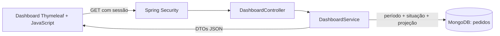

# Dashboard administrativo — Pediu Patrão

## Escopo e acesso

Painel integrado à aplicação Spring Boot existente, disponível em `/dashboard` e no menu lateral para **ADMIN e GERENTE**. A API utiliza a sessão de login do sistema. ATENDENTE não possui acesso aos dados gerenciais, inclusive por chamada direta à API.

## Requisitos funcionais

| ID | Requisito | Implementação |
| --- | --- | --- |
| RF01 | Indicadores gerais | Faturamento líquido, quantidade de pedidos, pedidos válidos, ticket médio, em andamento e cancelados. |
| RF02 | Análise de vendas | Gráfico de barras por dia ou mês, com períodos sem movimento preenchidos com zero e tabela acessível dos valores. |
| RF03 | Situação dos pedidos | Quantidade e proporção por situação; lista dos vinte pedidos mais recentes do filtro. |
| RF04 | Produtos mais vendidos | Dez produtos com maior quantidade, descrição histórica e valor bruto vendido. |
| RF05 | Filtros | Data inicial, data final, situação e agrupamento; atalho para mês atual. Todos os componentes usam o mesmo filtro. |
| RF06 | Integração com API | Consulta assíncrona dos endpoints de filtros e resumo, sem recarregar a página. |
| RF07 | Atualização e tratamento | Atualização manual, automática opcional a cada 60 segundos, horário da última consulta, carregamento, período vazio, erros e indicação de dados desatualizados. |

## Requisitos não funcionais

| ID | Requisito e critério |
| --- | --- |
| RNF01 | Segurança: autorização no backend, sessão existente, CSRF preservado, respostas sem dados pessoais de clientes ou detalhes de conexão. |
| RNF02 | Exatidão: cálculos monetários com `BigDecimal`, duas casas e arredondamento HALF_UP; nenhuma divisão por zero. |
| RNF03 | Usabilidade: interface em português, valores em reais, layout adaptável, rótulos nos campos, foco visível e mensagens anunciadas por leitores de tela. |
| RNF04 | Eficiência: consulta por período no MongoDB, projeção dos campos necessários, máximo de 366 dias, dez produtos e vinte pedidos no retorno. A agregação ocorre em memória: grandes volumes exigem evolução para pipeline de agregação. |
| RNF05 | Confiabilidade: timeout de 20 segundos no cliente; erros não são convertidos em vendas iguais a zero; atualização não sobrepõe requisições e pausa automaticamente quando a aba está oculta. |
| RNF06 | Manutenção: serviço de cálculo separado do controlador REST e da apresentação, testes reproduzíveis e documentação versionada. |
| RNF07 | Dependências: Java 21 e stack existente; gráfico SVG sem nova biblioteca ou serviço externo. O layout existente mantém Bootstrap via CDN. |

## Regras de negócio

1. O período considera `Pedido.dataHoraEntrada`: início inclusivo à meia-noite e fim exclusivo à meia-noite do dia seguinte. Datas iniciais e finais podem coincidir; o intervalo máximo inclusivo é de 366 dias.
2. O mês corrente e o horário da atualização usam `America/Sao_Paulo`. As datas históricas são `LocalDateTime`, conforme o modelo existente, interpretadas como horário local da operação. Executar a aplicação com `TZ=America/Sao_Paulo` ou `-Duser.timezone=America/Sao_Paulo` mantém também a conversão MongoDB consistente. Não há migração automática de históricos gravados em outro fuso.
3. **Pedidos válidos** são os não cancelados. O faturamento soma seus `valorTotal` persistidos, já com desconto. Inclui pedidos em andamento e não constitui confirmação de recebimento financeiro.
4. Ticket médio = faturamento / pedidos válidos. Sem pedidos válidos, o ticket é `0.00`.
5. Em andamento = pedidos que não estão FINALIZADO nem CANCELADO. RETIRADO e SAIU_PARA_ENTREGA continuam em andamento até a finalização.
6. Contagem total, situações e lista recente incluem cancelados. O filtro de situação afeta também receita, gráfico e ranking; selecionar CANCELADO zera os indicadores de vendas e mantém a informação operacional.
7. Ranking soma quantidades de itens de pedidos válidos por `produtoId`, ordena por quantidade decrescente e desempata pelo ID. O valor bruto é quantidade × preço histórico unitário, **antes** do desconto global. Não equivale ao faturamento líquido. Produtos excluídos do catálogo continuam no histórico. A descrição usa o valor registrado nos itens; se um produto tiver descrições diferentes, a descrição de um dos itens consultados é exibida.
8. Pedidos sem data de entrada ficam fora da consulta. Valor total nulo é tratado como zero. Itens nulos, sem ID, sem preço ou com quantidade não positiva ficam fora do ranking. Pedidos legados sem itens ainda participam dos demais totais; o painel não inventa itens históricos. Status nulo participa do total/em andamento, mas não é atribuído artificialmente a uma situação.
9. A lista recente é ordenada por entrada decrescente e ID como desempate, limitada a vinte. Não substitui a listagem operacional completa.
10. Uma leitura do banco alimenta todos os painéis. A API é somente de leitura e não altera pedidos.

## Arquitetura e modelo de dados



Não é necessária uma nova coleção. A fonte é `pedidos`: `_id`, `numeroPedido`, `dataHoraEntrada`, `status`, `valorTotal` e `itens[{produtoId, descricao, quantidade, precoUnitario}]`. Os itens preservam preço e descrição da venda; não se recalcula o histórico usando o preço atual do catálogo. A projeção exclui cliente, entregador, responsáveis e justificativas.

Índices recomendados, a serem aplicados pelo responsável pelo banco, no `mongosh`:

```javascript
use pediupatrao
db.pedidos.createIndex({dataHoraEntrada: 1}, {name: "dashboard_entrada"})
db.pedidos.createIndex({status: 1, dataHoraEntrada: 1}, {name: "dashboard_status_entrada"})
```

Não há criação automática desses índices nem medição de desempenho em banco de produção nesta entrega.

## API

Base: `/api/dashboard`. Respostas JSON; autenticação pelo cookie `JSESSIONID` gerado no login. Os GETs não exigem token CSRF. A resposta não é armazenada em cache pelo Spring Security.

### GET /api/dashboard/filtros

Sem parâmetros. Fornece os valores aceitos no formulário.

```http
GET /api/dashboard/filtros
Accept: application/json
Cookie: JSESSIONID=<sessao-autenticada>
```

```json
{
  "situacoes": ["RECEBIDO", "EM_PREPARACAO", "PRONTO", "SAIU_PARA_ENTREGA", "RETIRADO", "FINALIZADO", "CANCELADO"],
  "agrupamentos": ["dia", "mes"],
  "maximoDias": 366,
  "fusoHorario": "America/Sao_Paulo"
}
```

### GET /api/dashboard/resumo

| Parâmetro | Tipo | Padrão | Validação |
| --- | --- | --- | --- |
| `inicio` | Data `AAAA-MM-DD` | Primeiro dia do mês atual em Brasília | Data válida; não pode ser posterior a `fim`. |
| `fim` | Data `AAAA-MM-DD` | Hoje em Brasília | Até 365 dias depois de `inicio` (366 dias inclusivos). |
| `status` | Texto | Todas as situações | Enum do endpoint de filtros; aceita minúsculas. Vazio equivale a todas. |
| `agrupamento` | Texto | `dia` | `dia` ou `mes`. |

```http
GET /api/dashboard/resumo?inicio=2026-11-01&fim=2026-11-01&status=FINALIZADO&agrupamento=dia
Accept: application/json
Cookie: JSESSIONID=<sessao-autenticada>
```

Exemplo ilustrativo de um pedido com duas pizzas de R$ 25 e desconto de 10%:

```json
{
  "inicio": "2026-11-01",
  "fim": "2026-11-01",
  "agrupamento": "dia",
  "status": "FINALIZADO",
  "atualizadoEm": "2026-11-10T10:00:00",
  "indicadores": {"pedidos": 1, "vendas": 1, "cancelados": 0, "emAndamento": 0, "faturamento": 45.00, "ticketMedio": 45.00},
  "vendas": [{"periodo": "2026-11-01", "pedidos": 1, "faturamento": 45.00}],
  "situacoes": [
    {"status": "RECEBIDO", "quantidade": 0},
    {"status": "EM_PREPARACAO", "quantidade": 0},
    {"status": "PRONTO", "quantidade": 0},
    {"status": "SAIU_PARA_ENTREGA", "quantidade": 0},
    {"status": "RETIRADO", "quantidade": 0},
    {"status": "FINALIZADO", "quantidade": 1},
    {"status": "CANCELADO", "quantidade": 0}
  ],
  "produtos": [{"produtoId": "pizza", "descricao": "Pizza calabresa", "quantidade": 2, "valorBruto": 50.00}],
  "pedidosRecentes": [{"id": "pedido-1", "numeroPedido": 1, "entrada": "2026-11-01T18:30:00", "status": "FINALIZADO", "valorTotal": 45.00}]
}
```

No agrupamento mensal, `periodo` tem formato `AAAA-MM`. Sem resultados, a API retorna **200** com indicadores zero, sete situações zeradas, série temporal preenchida com zeros e listas de produtos e pedidos vazias.

### Erros

| HTTP | Condição | Exemplo de `message` |
| --- | --- | --- |
| 400 | Data malformada ou inexistente | `Datas devem usar o formato AAAA-MM-DD.` |
| 400 | Período invertido ou maior que 366 dias | `Informe um período de 1 a 366 dias, com início anterior ou igual ao fim.` |
| 400 | Agrupamento desconhecido | `Agrupamento deve ser dia ou mes.` |
| 400 | Situação desconhecida | `Status de pedido inválido: INEXISTENTE` |
| 401 | Sem sessão ou sessão expirada | `Sessão expirada. Entre novamente.` |
| 403 | Perfil sem acesso | `Acesso negado para este perfil.` |
| 503 | Falha de acesso ao MongoDB | `Dados temporariamente indisponíveis. Tente atualizar novamente.` |

Corpo de erro: `{"message":"Descrição do erro."}`. Na página HTML, o login continua usando o fluxo de formulário do sistema; a resposta JSON 401 aplica-se à API.

## Executar e testar

Produção/desenvolvimento com MongoDB: siga o [README](../README.md), autentique como administrador ou gerente e abra `http://localhost:8080/dashboard`.

No Linux/macOS, use `sh ./mvnw` em lugar de `.\mvnw.cmd` nos comandos abaixo; o wrapper está versionado sem permissão de execução.

```powershell
.\mvnw.cmd test
node --check src/main/resources/static/js/dashboard.js
```

Prévia de interface sem MongoDB (somente classpath de teste, dados fictícios em memória):

```powershell
.\mvnw.cmd test-compile '-Dexec.mainClass=com.umc.pediupatrao.preview.DashboardPreview' '-Dexec.classpathScope=test' '-Dexec.args=--server.port=8081 --server.address=127.0.0.1' org.codehaus.mojo:exec-maven-plugin:3.5.0:java
```

Abra `http://127.0.0.1:8081`, usuário `demo`, senha `dashboard-demo`. Essa prévia oferece apenas login e dashboard; não é um servidor operacional de pedidos. O repositório MongoDB é simulado, mas controlador REST, segurança, serviço de cálculo, templates e JavaScript são os da implementação. Ela não é incluída no JAR de produção. Encerre com Ctrl+C.

Evidências, cobertura e limitações: [testes do dashboard](testes-dashboard.md).
