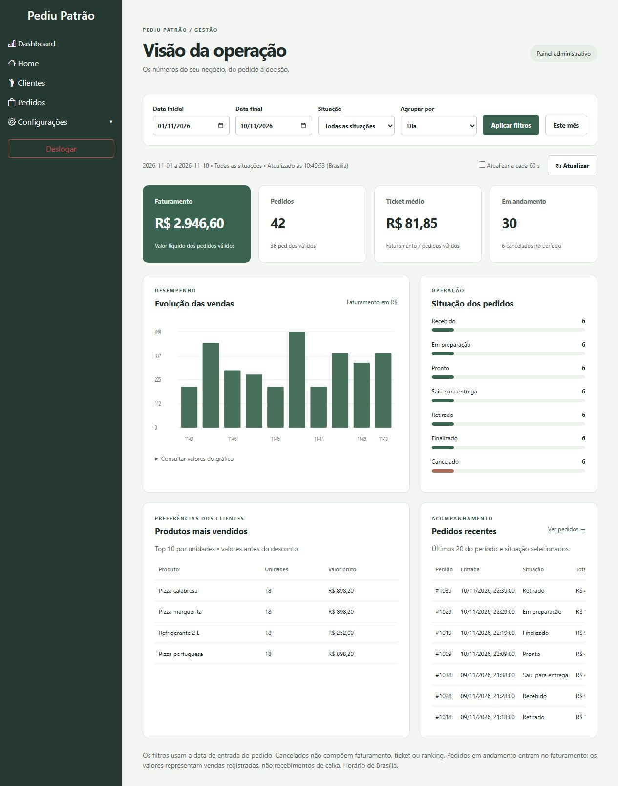
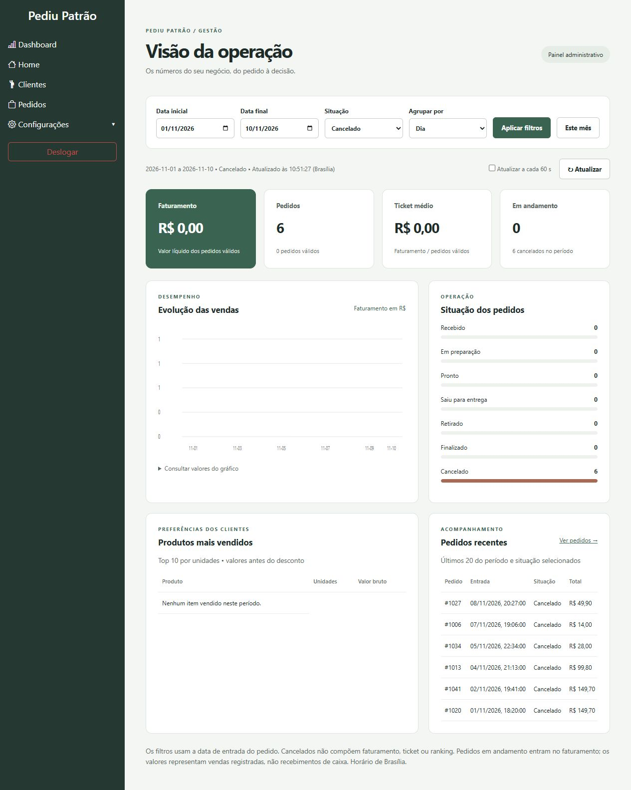
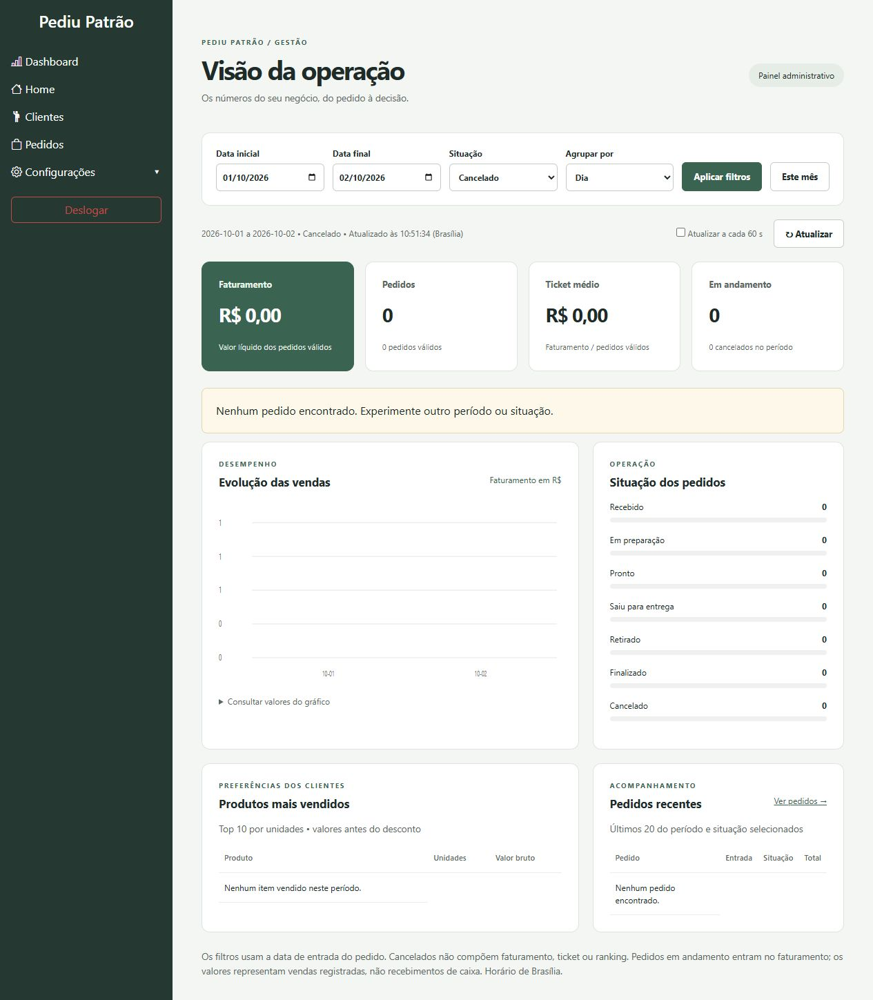
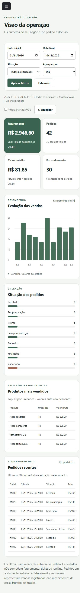

# Evidências de testes — Dashboard

Verificação realizada em **10/11/2026**, com Java 21.0.12.1, Maven e Spring Boot 3.4.4.

## Testes automatizados

Comando: `mvn -B test` (ou `./mvnw test` / `.\mvnw.cmd test`). Os testes usam MongoTemplate simulado e MockMvc com a configuração real de segurança. Não exigem MongoDB nem acesso a dados de produção.

Resultado: **17 testes executados, 0 falhas, 0 erros, 0 ignorados — BUILD SUCCESS**.

A verificação final `mvn -B verify` também passou e gerou o JAR executável. A inspeção do JAR confirmou a presença das classes de dashboard e a ausência da prévia e do Mockito no pacote de produção. [Resumo da execução final](evidencias/verify.txt).

| Camada | Casos verificados | Resultado |
| --- | --- | --- |
| Serviço (8 testes) | Receita após desconto, ticket, exclusão dos cancelados, contagem por situação e ranking bruto. | Aprovado |
| Serviço | Período vazio, divisão por zero e dias sem movimento. | Aprovado |
| Serviço | Agrupamento mensal e mês sem vendas. | Aprovado |
| Serviço | Rejeição de período invertido, excesso de dias e agrupamento inválido antes de consultar o banco. | Aprovado |
| Serviço | Query MongoDB com início inclusivo, fim exclusivo, situação e projeção de campos. | Aprovado |
| Serviço | Limites de dez produtos e vinte pedidos, ordenação do ranking e pedidos recentes. | Aprovado |
| Serviço | Pedidos legados sem valor total ou itens. | Aprovado |
| Serviço | Período de um dia e limite inclusivo de 366 dias. | Aprovado |
| API/segurança (9 testes) | Sem autenticação retorna 401 JSON. | Aprovado |
| API/segurança | ATENDENTE retorna 403 JSON e não chama o serviço. | Aprovado |
| API/segurança | ADMIN acessa catálogo de filtros. | Aprovado |
| API/segurança | GERENTE acessa resumo JSON com filtros explícitos. | Aprovado |
| API/segurança | Data inexistente, status desconhecido e agrupamento inválido retornam 400. | Aprovado |
| API/segurança | Falha do banco retorna 503 sem revelar detalhes internos. | Aprovado |
| API/segurança | Datas omitidas usam mês atual no fuso de Brasília. | Aprovado |

Relatórios gerados pelo Surefire e preservados nesta entrega:

- [Serviço](evidencias/DashboardServiceTest.txt)
- [Controlador e segurança](evidencias/DashboardControllerTest.txt)

Verificação de sintaxe: `node --check src/main/resources/static/js/dashboard.js`, concluída sem erros. A automação em `.github/workflows/testes.yml` executa `mvn verify` e essa checagem a cada push/PR, disponibilizando os relatórios como artefato. A inclusão do workflow não constitui evidência de execução remota; consulte a aba Actions após o envio.

## Verificação no navegador

Foi usada a classe `DashboardPreview` no classpath de teste, com **42 pedidos fictícios**. Ela substitui somente o acesso a dados e a busca de credenciais. O servidor HTTP, a sessão, o CSRF, o controle de acesso, a API, os cálculos e os templates são reais.

| Cenário | Resultado observado |
| --- | --- |
| Entrar pelo formulário | Sessão criada e dashboard renderizado. |
| Visão geral | 42 pedidos, 36 válidos, seis cancelados, faturamento R$ 2.946,60, ticket R$ 81,85 e trinta em andamento. |
| Selecionar CANCELADO e aplicar | Seis pedidos; faturamento, ticket e ranking de vendas zerados; lista recente mantém os cancelados. |
| Consultar 01–02/10/2026 | Mensagem de ausência de pedidos, indicadores e situações zerados, listas vazias. |
| Atalho Este mês | Restaura datas do mês atual, todas as situações e agrupamento diário. |
| Tela de 390 × 844 | Formulário e indicadores se reorganizam; tabelas possuem rolagem interna. Medição DOM: largura do documento 375 px, sem transbordamento horizontal da página. |

### Visão geral (dados fictícios)

### Filtro de cancelados

### Período vazio

### Tela pequena

## Limites da verificação

Não foi configurado um MongoDB real neste ambiente. A conexão, a conversão de datas do banco e os índices precisam ser verificados com a configuração do estabelecimento. A suíte verifica a construção da query e os cálculos sobre documentos representativos, mas não substitui um teste de integração com o banco.

O timeout do cliente, a atualização automática de 60 segundos e a interrupção de rede estão implementados, mas não foram exercitados no navegador nesta rodada. Não foram feitos testes de carga, auditoria completa de acessibilidade ou medição de tempo de resposta em produção.

Para a homologação com MongoDB: criar pedidos pelo sistema em situações diferentes, incluindo cancelamento e desconto; comparar os totais com os documentos do período; consultar o último minuto do dia final; testar expiração da sessão; interromper a conexão ao banco e verificar a mensagem; habilitar a atualização automática e conferir a mudança após novo pedido. Utilize ambiente de teste.
